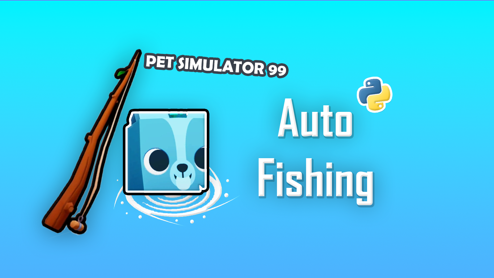

<p align="center">
  
</p>

# Pet Simulator 99 – Auto Fishing

A small Python tool that finds the fishing spot ("deep pool" bubble) on your screen and moves the mouse onto it, so you don't have to aim by hand.

> **Note:** this tool only **moves** the mouse. It does **not click**. For the clicking part, use a separate auto clicker of your choice (set to click at the current cursor position) alongside it.

## How it works

1. Takes a screenshot of your screen.
2. Uses OpenCV template matching to look for the bubble images stored in `reference_images/`.
3. If a match is good enough (confidence > 0.6), it moves the mouse to the center of the match (and nudges it 1 pixel).
4. Repeats until you turn it off.

## Download (no Python needed)

Grab the latest `PS99-AutoFish-v1.0-windows.zip` from the [Releases](../../releases) page, unzip it, and run `PS99-AutoFish.exe`. Keep the `reference_images` folder next to the exe.

> Antivirus programs sometimes flag PyInstaller-built `.exe` files that read the keyboard and move the mouse. It's a false positive, but if you'd rather not trust a binary, run it from source below.

## Run from source

Requirements: Windows (it uses `pydirectinput`) and Python 3.10+.

```bash
git clone https://github.com/leafranger/ps99-auto-fish.git
cd ps99-auto-fish
pip install -r requirements.txt
python main.py
```

Run it **from the project folder** (it loads `./reference_images`).

## Usage

1. Open Pet Simulator 99 and go to a fishing spot.
2. Start the tool (exe or `python main.py`).
3. Press **Ctrl + Shift + F** to start / stop it.
4. Start your auto clicker separately.

## Customizing

- **Detection accuracy:** change `threshold` in `main.py` (lower = more matches, but more false positives).
- **Different spot or screen setup:** replace the images in `reference_images/` with screenshots of what you want to detect, cropped tightly around the target. Only `.png` and `.jpg` files are loaded.
- **Build your own exe:** `pip install pyinstaller`, then `pyinstaller --onefile main.py`.

## Disclaimer

This is an old hobby project, shared for learning purposes. It is not affiliated with or endorsed by Roblox or Big Games. Using automation in online games may go against their Terms of Service and could get your account banned. Use it at your own risk.

## License

Released under the [GNU General Public License v3.0](LICENSE): you can use, modify and share it freely, but any modified version you distribute must also be released under GPL-3.0 with its source code available.
